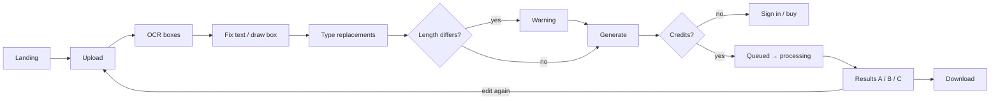
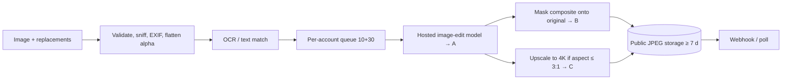

# Teardown: rewords.ai (reference product)

Studied 2026-11-10 from public pages only: home, pricing, developers landing, API docs (overview, reference for OCR/edit/get-edit, images, webhooks, errors, queue and limits, results and refunds, FAQ), blog index, terms, privacy. No sign-up, no uploads, no editor use, no endpoint calls. Playwright walk-through, network capture and quality baselines were skipped for this run, so the editor flow and quality notes below come from public descriptions only. Everything is paraphrased; nothing here may be copied into product code or UI.

## Feature inventory

| Area | What they offer (public claims) | Glyphswap today (SPEC) |
| --- | --- | --- |
| Core edit | Replace text in an image, keeping font, color, size, shadow, lighting, background | Same goal (Result B classic pipeline) |
| Removal | Empty replacement removes text and fills the background | `remove: true` |
| Detection | OCR lists every line; user fixes misreads | OCR lines with polygons |
| Manual boxes | User draws a box around missed text | `box` edits, `B` shortcut |
| Many edits | Unlimited boxes per image in UI; up to 20 replacements per API edit | Unlimited boxes |
| Length warning | Warns when new text length differs a lot from the old | Not specified |
| Result variants | A = AI redraw of whole image, B = text blended into untouched original, C = 4K upscale when aspect ≤ 3:1 | A diffusion (flag), B classic, C Real-ESRGAN (flag) |
| Style overrides | None; font/color/size are always copied | Right rail overrides font, size, color |
| Languages | 40+ claimed on marketing; API OCR lists 10 codes (en, zh, ja, ko, fr, de, es, pt, it, ru); Arabic, Hebrew, Thai, Hindi unsupported | 40+, Latin, Devanagari, Telugu tested |
| Hard cases | Claims handwriting, curved text, textures, noisy screenshots; API FAQ admits handwriting, stylized, curved and vertical text may be missed | Curved baseline warp |
| Inputs (web) | PNG, JPG (WebP mentioned), ≤ 8 MB | PNG, JPG, WebP ≤ 8 MB, ≤ 4096 px |
| Inputs (API) | JPEG, PNG, WebP sniffed from bytes, ≤ 20 MB, 32–8000 px, RGB/grey only (CMYK rejected), first frame of animated WebP, alpha flattened to white, EXIF orientation applied | multipart or URL |
| Input methods | URL (≤ 3 redirects, 15 s, no private IPs), base64 (data URL ok), multipart `image`, `image_id` from OCR (24 h) | multipart, URL, `image_id` |
| Output | JPEG, no watermark, public links kept ≥ 7 days | Storage URLs, 72 h retention |
| Iteration | Re-edit by submitting a result URL as a new (billed) job | Not specified |
| Translation | Marketed as a use case | Not specified |
| Accounts | Google or email one-time code | Better Auth email/password + Google |
| History | `/history` page | `/app/history` |
| API keys | Up to 5 keys per account, self-serve page, separate API balance | `/settings/api` |
| Payments | Stripe, PayPal, Alipay | None in v1 |
| Retention | Deleted within 72 h (site, terms, privacy) | 72 h |
| Responsible use | Terms forbid forging IDs, certificates, receipts, invoices, bank records; content review blocks some images | Terms forbid forgery |

## UX flow (as described publicly)

1. Land on home page with the upload area above the fold.
2. Upload an image (drag/drop or picker); type and size checked client-side.
3. OCR runs; detected lines appear as editable boxes.
4. Fix any misread text, draw boxes for missed text.
5. Type replacement text per box (empty = remove); length warning if it differs a lot.
6. Generate; sign-in required after the first free edit, low-credit prompt at zero.
7. Wait (marketing says under a minute; API docs say 1–2 min typical).
8. Compare results A/B (C when available), download.

## Inferred architecture and pipeline

Inference only; nothing below is confirmed by them.
- **Third-party generative model for A.** The privacy policy names unnamed "AI service providers" processing images, A "redraws the whole image", jobs take 1–2 min, the per-account concurrency cap is 10, and the error list includes `content_blocked` raised mid-job. This fits a hosted image-edit model with its own safety filter, not a self-hosted pipeline.
- **B is derived from A.** B keeps every pixel outside the text untouched, so it is most likely A's text regions composited back onto the original through a mask. B never exists without the generative step, which explains why A and B succeed or fail together.
- **C is a separate upscaler** limited to aspect ≤ 3:1 (typical of tile-based 4K upscalers). It never affects billing.
- **OCR** returns axis-aligned line boxes (`[x, y, w, h]`-looking integers, no polygon or angle), defaults to Chinese+English, needs an explicit language code, and lowercases or drops spaces at times. That looks like a PaddleOCR-family recognizer with per-language models.
- **Text location without OCR.** `from`/`to` matching runs OCR internally: case-insensitive, trims spaces, exact line matches win, else all substring occurrences, then a retry that ignores spaces; `422 text_not_found` returns candidate boxes.
- **Job system.** Queue with per-account concurrency 10 + 30 waiting, 10-min hard timeout, credit reserved on submit and released on failure, idempotency keys kept 24 h, results on public object storage (JPEG) for ≥ 7 days.

## API contract (as documented publicly)

- Base `https://api.<their-domain>/v1`, `Authorization: Bearer <prefix>_live_…`, JSON or multipart, UTC timestamps, versioned path, additive changes only. Server-to-server only (no CORS). OpenAPI file published; no official SDK; Node and Python example clients.
- `POST /ocr`: exactly one of `image_url | image_base64 | image_id` (or multipart `image`), optional `language`. `200 { image_id, width, height, texts: [{ id, text, box }], charged_ocr }`. Same image within 24 h is charged once; `image_id` reusable 24 h by the same account.
- `POST /edits`: one image source, `replacements: [{ from, to, box? }]` (1–20, ≤ 200 chars each, `\n` for line breaks, `to: ""` removes), `match: all|first`, `language?`, `callback_url?` (https only, query string kept), header `Idempotency-Key` (≤ 128 chars, 24 h). `202 { id, status, queue_position, estimated_seconds, charged, balance, created_at }`.
- `GET /edits/{id}`: `status: queued|processing|succeeded|failed`, `queue_position` (0 = next), `estimated_seconds`, `results: { A|B|C: { status: succeeded|failed|skipped, url? , reason? } }`, `replacements` as applied (one per changed line, with `box`), `charged`, `balance`, `error?`, `created_at`, `completed_at`.
- `GET /account`: balances (`edits_remaining`, OCR balance) and current limits.
- Webhook `editCompleted`: POST with the same body as `GET /edits/{id}` on `succeeded|failed`; header `X-<Vendor>-Signature: sha256=<hex>` = HMAC-SHA256 of raw body with the account secret (`whsec_` prefix, rotatable); 2xx within 10 s; retries after 1, 5, 30 min with identical bytes; no timestamp/replay header, dedupe by `id`; clients should also poll after 15 min.
- Errors: `{ error: { code, message, details } }`. Request errors: `400 invalid_request`, `400 invalid_image`, `401 invalid_api_key`, `402 insufficient_balance`, `402 insufficient_ocr_balance`, `403 image_blocked`, `404 not_found`, `422 text_not_found` (with `details.texts`), `429 rate_limited` (+ `Retry-After`), `500 upstream_failed`, `503 queue_full` (+ `Retry-After`). Job errors: `content_blocked`, `ai_generation_failed`, `timeout`, `upstream_failed`, `invalid_image`. None charged.
- Rate limits: rolling 60 s per account across keys: 30 submissions, 240 reads; rejected calls count. Only `Retry-After` is documented, no `X-RateLimit-*` headers.
- Polling advice: 5 s while processing or at queue position 0, 30 s further back.
- No cancel endpoint.

## Limits and pricing

- Web: 1 free edit on signup, no card. 1 credit = 1 image, unlimited boxes. Pay-as-you-go packs roughly $0.39–0.59 per image, monthly plans roughly $0.19–0.29, annual roughly $0.16–0.24. Credits never expire; monthly credits roll over. Failed edits auto-refund.
- API: separate balance, one-time packs from $50 (60 edits) to $500 (2,500 edits), valid 12 months, roughly $0.20–0.83 per edit; OCR $0.01 per call beyond bundled calls; OCR inside an edit is free. No free API test keys.
- Throughput: 10 concurrent + 30 queued per account, 10-min job timeout, 1–2 min typical, ~90% under 3 min, up to ~30 min when the queue is full.
- Sizes: web 8 MB PNG/JPG; API 20 MB, 32–8000 px, 28 MB JSON body.

## Quality notes (public claims only, not measured)

- Strengths claimed: font/color/shadow/lighting kept, handwriting, curved text, textured backgrounds, noisy screenshots, "pixel-perfect" B with untouched surroundings.
- Weaknesses they admit: handwriting, stylized, curved and vertical text may be missed or split by OCR; Korean, Cyrillic and accented text misread without a language code; Arabic, Hebrew, Thai and Hindi (so all Indic scripts) unsupported; full-width/case/spacing OCR drift; long replacements get shrunk; A may alter small details elsewhere; no manual font/size/color control; 1–2 min latency; C skipped above 3:1.
- Not yet measured by us: baseline outputs on our samples (free visitor edit skipped this run). Phase 9 eval should compare against these claims rather than their outputs.

## Parity checklist

Binding on top of docs/SPEC.md. Each item has a one-line acceptance test.

- **P1** Upload PNG/JPG/WebP ≤ 8 MB in the web editor. Test: Playwright uploads a 7.9 MB PNG and a WebP; both show the canvas; a 9 MB file shows an inline error.
- **P2** OCR lists every text line with an editable value. Test: sample with 5 known lines returns 5 lines, each editable in the left rail.
- **P3** Draw a manual box for missed text. Test: press `B`, drag a box, type text; the edit is sent with `box`.
- **P4** Remove text by empty replacement or remove toggle. Test: removing a line yields Result B where OCR on the region finds no text.
- **P5** Unlimited boxes per image for one credit. Test: job with 25 edits debits exactly 1 credit in `credit_ledger`.
- **P6** Length-difference warning. Test: replacing a 5-char line with 15 chars shows a non-blocking warning in the editor.
- **P7** Result B leaves pixels outside dilated masks untouched. Test: pixel diff of original vs B outside the mask union is 0 for PNG input.
- **P8** Result A behind `ENABLE_DIFFUSION`; C behind `ENABLE_UPSCALE` and skipped with a reason above 3:1. Test: 4:1 image returns `C: { status: "skipped", reason: "aspect_ratio_unsupported" }`.
- **P9** Per-result status `succeeded | failed | skipped` with `url` or `reason`. Test: `GET /v1/jobs/:id` schema check with zod in a unit test.
- **P10** Compare and download each result. Test: Playwright toggles Original/A/B with `1/2/3` and downloads B.
- **P11** Charge only when at least one requested result succeeds; auto refund otherwise. Test: forced inference failure writes a `refund` ledger row and balance is unchanged.
- **P12** Free credits on signup without a card. Test: new user balance > 0 right after signup.
- **P13** History of past jobs. Test: `/app/history` lists the last job with thumbnail and status.
- **P14** `POST /v1/ocr` with multipart, `image_url`, `image_base64` or `image_id`; exactly one source. Test: two sources → `400 invalid_request`.
- **P15** `image_id` reusable for 24 h by the same user only. Test: another user's `image_id` → `404 not_found`.
- **P16** Edit by text match (`old_text`), by `line_id`, or by `box`, with `match: all | first`, case-insensitive, trimmed. Test: `{ old_text: "SALE" }` on an image with "sale" twice replaces both; with `first` replaces one.
- **P17** `422 text_not_found` returns candidate lines in `error.details`. Test: unmatched `old_text` → 422 with `details.lines` non-empty.
- **P18** `Idempotency-Key` on `POST /v1/edit` for 24 h. Test: same key twice returns the same `job_id` and one debit.
- **P19** Typed error codes with `{ error: { code, message, details? } }` and `Retry-After` on 429/503. Test: exceed rate limit → 429 with `Retry-After` and `X-RateLimit-*`.
- **P20** Per-account limits: 30 submits/60 s, 240 reads/60 s, 10 running + 30 queued, `503 queue_full`. Test: 41st queued job → 503 `queue_full`.
- **P21** Signed webhook with retries at 1, 5, 30 min and identical bytes. Test: receiver returning 500 gets 4 deliveries with the same signature.
- **P22** `GET /v1/account` returns balance and limits. Test: response includes `credits` and `limits.submit_per_min`.
- **P23** Up to 5 API keys per user, revocable, prefix shown once. Test: creating a 6th key → 400; revoked key → 401 `invalid_api_key`.
- **P24** Image validation at the edge: sniffed mime, CMYK rejected or converted, alpha flattened, EXIF orientation applied, 32 px min side. Test: rotated-EXIF JPEG yields OCR boxes in display orientation.
- **P25** URL fetch safety: ≤ 3 redirects, 15 s timeout, private IPs blocked. Test: `image_url` to `http://127.0.0.1/` → `400 invalid_image`.
- **P26** Multi-line replacement with `\n`, ≤ 200 chars per field. Test: `new_text: "a\nb"` renders two lines inside the box.
- **P27** Retention: uploads and results deleted after 72 h. Test: cron job deletes `image` rows past `expires_at` and their storage keys.
- **P28** Terms forbid forging IDs, certificates, receipts, invoices, bank records. Test: `/legal/terms` contains a prohibited-use section.
- **P29** Published OpenAPI and server-only API (no browser CORS for key auth). Test: `GET /v1/openapi.json` validates; a browser-origin request with a key gets no CORS headers.
- **P30** Re-edit a result. Test: "Edit again" on a result starts a new job using that result as the image.

## Where we beat it

- **B1 Open source and self-hostable.** Whole pipeline in the repo; `make dev` runs it locally on a Mac with no third-party AI provider; images never leave the machine.
- **B2 Transparent pipeline.** Each stage (OCR, mask, inpaint, style match, render, blend) is visible in job `stage`/`progress` and SSE, with per-stage timings, instead of an opaque 1–2 min wait.
- **B3 Speed.** Result B target p95 ≤ 15 s for 1024 px vs their 1–2 min typical.
- **B4 Indic and complex scripts.** Devanagari and Telugu tested with HarfBuzz shaping; they list Hindi as unsupported.
- **B5 Manual style control.** Font, size, color and angle overrides per box; they copy style only, with no override.
- **B6 Rotated and curved geometry.** OCR polygons + angle and baseline warp vs their axis-aligned boxes.
- **B7 Better webhooks.** Signature includes a timestamp for replay protection (`t=…,v1=…`), plus `X-RateLimit-*` headers; theirs has no replay window or rate headers.
- **B8 B does not depend on a generative model.** Classic pipeline produces B even with diffusion off or on CPU, so no `content_blocked`/`ai_generation_failed` failures for B.
- **B9 Free OCR and a free local tier.** OCR costs no credit; self-hosters pay nothing.
- **B10 Cancel.** `DELETE /v1/jobs/:id` cancels a queued job and refunds; they have no cancel.
