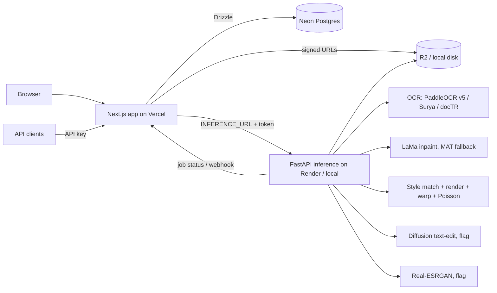

# Glyphswap — Product spec

## Product
Upload an image, see every line of text detected, then replace or remove any of it. The new text matches the original font, size, color, angle, texture and background. Open source, runs fully on a Mac (Apple Silicon/MPS), deployable to Vercel + Render.

- Inputs: PNG, JPG, WebP, ≤ 8 MB, ≤ 4096 px on the long side (downscale larger, keep original for C).
- Outputs per job: **Result B** (classic pipeline, blended), **Result A** (diffusion text-edit, flag), **Result C** (Real-ESRGAN upscale of the chosen result, flag).
- Billing model: 1 credit = 1 processed image, unlimited boxes. Free credits on signup. No payments in v1.
- Retention: uploads and results deleted after 72 h; edit metadata kept.
- Languages: 40+ via the OCR stack, with Latin, Devanagari and Telugu tested.

## Reverse-engineering scope
Phase 0 produces `TEARDOWN.md` from rewords.ai's public surfaces only (pages, docs, the public editor flow, network shapes visible in our own session, at most the free visitor edits on our own samples). Its **parity checklist (P1…Pn)** and **beat-it list (B1…Bn)** are binding requirements on top of this spec. Where TEARDOWN.md and this spec conflict, pick the stronger requirement and log it. Never copy their code, assets, copy or branding; never bypass auth, limits or paywalls.

## Architecture

Job lifecycle: `queued → ocr → masking → inpainting → rendering → blending → (diffusion) → (upscale) → done | failed`. The web app owns jobs in Postgres; inference reports progress back through a signed callback and SSE is relayed to the browser.

## Database (Drizzle, draft — Claude owns the final schema)
- `user`, `session`, `account`, `verification`: Better Auth tables.
- `image`: id, user_id, storage_key, width, height, mime, bytes, sha256, created_at, expires_at.
- `ocr_result`: id, image_id, engine, lang, created_at; `ocr_line`: id, ocr_result_id, text, polygon jsonb, angle, confidence, order.
- `job`: id, user_id, image_id, api_key_id null, status enum, stage, progress int, flags jsonb, error, webhook_url, created_at, started_at, finished_at.
- `edit`: id, job_id, line_id null, box jsonb, old_text, new_text, remove bool, font_family, font_size, color, angle.
- `result`: id, job_id, kind enum(A,B,C), storage_key, width, height.
- `credit_ledger`: id, user_id, delta int, reason enum(signup,job,refund,admin), job_id null, created_at. Balance = sum(delta); debit in the same transaction that creates the job, refund on failure.
- `api_key`: id, user_id, name, prefix, hash, last_used_at, revoked_at, created_at.
- `rate_event`: api_key_id, at (index on api_key_id, at) for the sliding window.
Indexes on every FK, `job(user_id, created_at desc)`, `image(expires_at)`.

## API contract (public)
Auth: `Authorization: Bearer gs_live_…`. JSON. Errors: `{ "error": { "code", "message" } }`. Rate limit headers `X-RateLimit-Limit/Remaining/Reset`.
- `POST /v1/ocr` multipart `image` or JSON `{ image_url }` → `200 { image_id, width, height, lines: [{ id, text, polygon: [[x,y]×4], angle, confidence }] }` (no credit).
- `POST /v1/edit` JSON `{ image_id | image_url, edits: [{ old_text, new_text } | { line_id, new_text } | { box: [x,y,w,h], new_text | remove: true }], results: ["B","A","C"], webhook_url? }` → `202 { job_id, status: "queued" }` (1 credit).
- `GET /v1/jobs/:id` → `{ job_id, status, stage, progress, results: { A?, B?, C? : { url, width, height } }, error? }`.
- Webhook: POST the same body as GET on terminal status, signed with `X-Glyphswap-Signature` (HMAC-SHA256).
- `GET /v1/openapi.json`.
Internal inference API (token auth): `POST /ocr`, `POST /jobs`, `GET /jobs/:id/events` (SSE), `GET /healthz`.

## Pipeline details
1. **OCR**: adapters for PaddleOCR PP-OCRv5 (v4 fallback), Surya, docTR. Bake-off on the eval set (CER, IoU, ms); pick default per script, keep a fallback. Output line polygons + angle.
2. **Mask**: polygons of selected lines, dilated 3–6 px scaled to font size, plus a stroke/shadow halo if detected.
3. **Inpaint**: LaMa (big-lama) via iopaint on MPS/CUDA/CPU; MAT when the masked area > 15% of the image; tile above 2048 px.
4. **Style match**: color by k-means (k=2–3) on the crop, text cluster = the one least like the inpainted background; size from box height and cap-height ratio; angle from polygon; font = render the old text in ~40 bundled Google Fonts (sans, serif, mono, display, handwriting, Noto Devanagari, Noto Telugu) and pick max SSIM against the binarized original crop; weight/italic variants for the top 3; detect stroke and drop shadow.
5. **Render**: Pillow (or skia-python) with tracking adjusted to fill the original width; multi-line wrap; RTL/complex scripts via HarfBuzz (raqm).
6. **Warp**: perspective transform onto the line polygon; curved text via baseline polyline from OCR when available.
7. **Blend**: OpenCV seamlessClone (Poisson) + Gaussian noise/grain and blur matched to the local patch statistics = Result B.
8. **Result A**: diffusion text-edit (AnyText / TextDiffuser-2 / newer open model) on the masked crop, `ENABLE_DIFFUSION`; verify license; GPU recommended.
9. **Result C**: Real-ESRGAN x2/x4, `ENABLE_UPSCALE`.
Devices: `TORCH_DEVICE=auto` → mps → cuda → cpu. Render CPU instances are fine for OCR + LaMa at ≤ 1024 px; Result A needs a GPU host (document Render GPU availability/cost or an alternative).

## UI
Pages: `/` landing, `/login`, `/signup`, `/app` editor, `/app/history`, `/app/jobs/[id]`, `/settings` (profile, theme), `/settings/api` (keys, usage), `/docs` (API), `/legal/terms`, `/legal/privacy`.

Design tokens:
- Type: Instrument Serif for display headings (italic accents), Geist Sans for UI and body, Geist Mono for code, kbd and labels.
- Scale: 12 / 14 / 16 / 18 / 24 / 32 / 48 / 72 px; line-height 1.5 body, 1.05 display.
- Spacing: 4 px base (4, 8, 12, 16, 24, 32, 48, 64, 96). Radius 6 / 10 / 16. Max content width 1200 px.
- Light: bg #FAFAF7, surface #FFFFFF, border #E7E5DF, text #111111, muted #6B6B66, accent #2F5BEA, accent-soft #E8EEFC, success #16A34A, danger #DC2626.
- Dark: bg #0B0B0C, surface #141416, border #26262A, text #F4F4F2, muted #9A9A94, accent #6E8BFF, accent-soft #1A2240.
- Motion: 150–250 ms ease-out, respect `prefers-reduced-motion`. Focus ring 2 px accent.
- Editor: canvas centered on a dotted grid, left rail with detected lines (editable inputs), right rail with style overrides (font, size, color, remove), top bar with Replace all, credits, compare toggle (Original / A / B), download. Boxes: 1 px accent outline, soft fill on hover, selected = solid handles. Keyboard: `R` replace all, `B` draw box, `Del` remove, `1/2/3` switch result, `⌘Z` undo.

## Non-functional
- p95 Result B ≤ 15 s for a 1024 px image with ≤ 10 boxes on an M-series Mac.
- Lighthouse ≥ 95 mobile on landing. WCAG AA.
- Uploads virus-size-checked, mime sniffed, EXIF stripped. Signed URLs expire in 15 min.
- Responsible use: terms forbid forging IDs, certificates, invoices or official documents; README states it.
